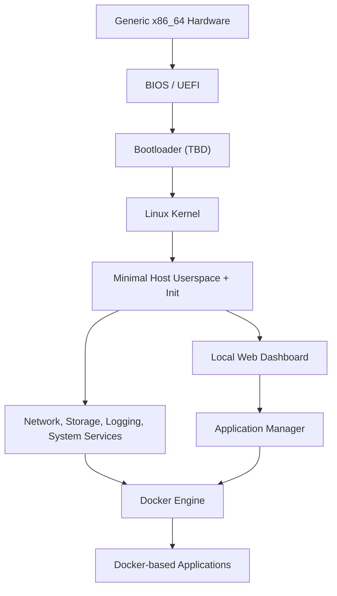

# RaviOS Architecture Overview

**Document status:** Initial proposal  
**Project status:** Early design / not yet implemented  
**Target:** Generic x86_64 hardware (Intel and AMD)

This document describes the intended system boundaries and the current working assumptions. It is not a final implementation specification. Decisions marked **TBD** must be validated through prototypes and testing.

## 1. Purpose

RaviOS is intended to be a small Linux-based Developer Appliance. It boots on generic x86_64 hardware, starts Docker, and provides a local management experience for the host and its Docker-based applications.

The key distinction from a conventional minimal Linux installation is the planned integrated Application Manager: users should be able to discover, install, configure, start, stop, update, and remove supported applications without manually assembling every Docker command.

## 2. High-level system model

The diagram is conceptual. Exact process boundaries, deployment modes, and boot dependencies remain subject to implementation.

## 3. Host operating system

The host should contain only components required to boot and operate the appliance:

- Linux kernel and hardware drivers.
- Minimal userspace (BusyBox is a candidate).
- An init/service supervision approach (**TBD**).
- Network configuration and name resolution.
- Storage and filesystem support.
- Docker Engine and its required runtime components.
- SSH server, enabled/configured according to the system's administration model.
- RaviOS-specific system services and configuration.

Python, Node.js, Go, databases, and similar development runtimes/services are not intended to be installed directly on the host. They should be supplied through Docker images.

The exact init system, libc/toolchain choices, filesystem layout, and package versions are **TBD**.

## 4. Build system

Buildroot is the planned system build framework.

RaviOS-specific configuration should live in a Buildroot External Tree rather than being mixed into the upstream Buildroot source checkout. At minimum, the external tree needs:

- `external.desc`
- `external.mk`
- `Config.in`

It may also contain defconfig files, board-specific kernel configuration, root filesystem overlays, package recipes, and post-build or post-image scripts as the implementation requires.

The Buildroot release or commit must be pinned once the first reproducible build is established. Buildroot source and generated output should not be committed to the RaviOS repository.

## 5. Docker and application workloads

Docker is the central workload runtime.

The host is responsible for starting and maintaining Docker. Applications such as development environments, databases, reverse proxies, dashboards, and monitoring tools are expected to run as containers when practical.

The Application Manager will manage Docker-based applications. Its initial responsibility is application lifecycle management:

- Discover and display available applications.
- Install and configure an application.
- Start and stop an application.
- Enable or disable automatic startup.
- Update an application.
- Remove an application while making data-retention behavior explicit.

The Application Manager is not intended to replace Docker. It is a RaviOS control layer that uses Docker to perform application operations.

### Application definitions

The application catalog and manifest format are **not designed yet**. The eventual format must describe, at a minimum, an application's identity, deployment definition, configuration inputs, persistent data, network exposure, dependencies, and lifecycle behavior.

Do not treat any early YAML example as a stable schema. The format should be designed after the lifecycle and configuration requirements are documented.

## 6. Management interface and Docker access

The planned web dashboard is local-first and should bind to `127.0.0.1` by default.

The current project assumption is that the dashboard/Application Manager may access the Docker socket directly. Access to the Docker socket is effectively highly privileged because it can control containers and, depending on configuration, affect the host. Therefore:

- Do not expose the Docker socket over an unauthenticated TCP endpoint.
- Do not bind the management dashboard to all network interfaces by default.
- Keep loopback binding as the default behavior.
- Any future option to expose the dashboard on a LAN must be an explicit configuration decision with appropriate access controls and documentation.

SSH is a separate system-administration channel and should be configured independently of the web dashboard.

## 7. Storage and persistence

The system needs a clear separation between replaceable operating-system files and persistent application/user data.

A likely direction is:

- A boot/EFI area where required by the selected boot mode.
- A system area containing the RaviOS image.
- A persistent data area for Docker's data root, application configuration, and user data.

The exact partition table, filesystem, mount points, read-only strategy, recovery design, and update/rollback model are **TBD**. These choices must be tested with Docker's storage requirements before they are finalized.

Data deletion behavior must be explicit when an application is removed. Removing an application should not silently delete persistent volumes unless the user explicitly requests that behavior.

## 8. Networking and remote administration

The initial system should support a practical wired-network setup, with DHCP as the simplest first milestone. Static addressing can be added as a configuration feature.

SSH is planned for remote system administration. The web dashboard remains loopback-only by default. Firewall policy, supported network interfaces, Wi-Fi scope, and remote dashboard access are **TBD**.

## 9. Boot sequence (intended)

The intended high-level boot sequence is:

1. Firmware initializes hardware.
2. Bootloader loads the Linux kernel and root filesystem.
3. Kernel initializes devices and mounts the root filesystem.
4. Init starts essential system services.
5. Network and persistent storage are initialized.
6. Docker starts after its required kernel and filesystem dependencies are available.
7. Enabled application workloads are started.
8. Local management services become available.

The exact dependency graph and failure/retry behavior will be defined during implementation.

## 10. Reliability and update strategy

The first milestone prioritizes a reproducible image and a reliable boot. A/B system partitions, automatic rollback, recovery mode, and unattended updates are not assumed for the first prototype.

The project should eventually define:

- How system images are versioned and built reproducibly.
- How Docker and application updates are performed.
- How persistent data is backed up and restored.
- What happens when Docker or an application fails to start.
- How logs and diagnostics are collected.
- How a failed system update can be recovered.

## 11. First technical milestone

The first milestone is deliberately small:

- Build a minimal x86_64 image with Buildroot.
- Boot it successfully in QEMU.
- Reach a shell.
- Confirm basic CPU, memory, and device visibility.
- Display the RaviOS name and version.
- Shut down cleanly.

Docker, the dashboard, and the Application Manager are subsequent milestones. This order reduces debugging complexity by proving the boot foundation before adding higher-level services.

## 12. Open decisions

The following decisions remain open and should be made with evidence from prototypes:

| Topic | Current status |
|---|---|
| Buildroot release/commit | TBD; pin after initial build |
| Bootloader and BIOS/UEFI strategy | TBD |
| Init system and service supervision | TBD |
| libc and toolchain configuration | TBD |
| Kernel configuration and driver baseline | TBD |
| Root filesystem format and mutability | TBD |
| Persistent partition layout and filesystem | TBD |
| Docker package/version and configuration | TBD |
| Application manifest schema | Deferred until requirements are clear |
| Dashboard and backend technology | TBD |
| Update, recovery, and rollback design | Later milestone |
| Project license | Not selected |

## 13. Architectural principles to preserve

1. Keep the host minimal; put development runtimes and application services in containers.
2. Keep RaviOS customizations outside the upstream Buildroot source tree.
3. Keep application management separate from the operating-system build system.
4. Keep persistent application data separate from replaceable system files.
5. Keep management endpoints local-only by default.
6. Prefer a working, testable vertical slice over premature abstractions.
7. Record consequential decisions and revise this document when implementation evidence changes them.
