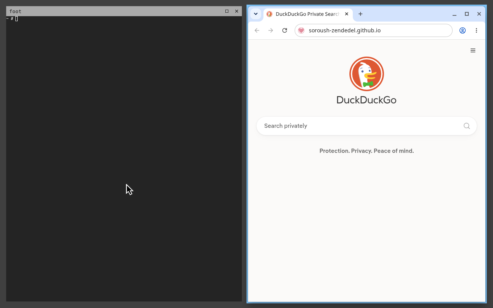

# RaviOS Development Update: Native Desktop and Chromium

**Date:** 2026-11-22
**Branch:** `develop/native-desktop-niri`
**Previous committed desktop milestone:** `milestone/native-niri-desktop` (`63f502b`)
**Review baseline:** `a28c179` (`docs: add first native desktop launch screenshot`)
**Proposed next milestone tag:** `milestone/native-desktop-browser`
**Status:** Experimental integration; final build and reboot validation still required

---

## 1. Summary

This update records the work accumulated after the initial native Niri desktop milestone. The visible result is a RaviOS graphical session with a native Foot terminal and a Chromium browser running side by side.

The supplied screenshot is included as a development artifact. It shows the Foot terminal on the left and a Chromium window displaying DuckDuckGo on the right.

*User-provided development screenshot, 2026-11-22.*

This is evidence of a successful graphical session at the time of capture. It is not, by itself, evidence of a clean-room build, successful repeated boots, complete GPU acceleration, or production security.

## 2. Changes found in the working tree

The repository archive contains the following uncommitted work relative to `a28c179`.

### 2.1 Build orchestration

`build.ps1` has been extended to:

- Resolve the Compose project and configured development image.
- Inspect the local development image and rebuild it when it appears older than the development Dockerfile.
- Recreate the `ravios-dev` container when it is stopped, uses a different image, or lacks the expected Buildroot External Tree mount.
- Preserve named Docker volumes during container recreation.
- Prepare the offline Chromium image before the Buildroot image build.
- Resolve relative `-OutputPath` values from the project root.
- Organize VirtualBox and VMware output files into separate directories.
- Remove intermediate RAW images after successful VM conversion.

A clean-checkout issue was identified during review: `artifacts/` was required before Compose startup but was not created by the build script. The script now creates this directory before it is used as a bind mount.

### 2.2 Chromium image and offline packaging

New Docker assets define a Chromium image based on Debian Bookworm. The PowerShell helper saves the image as:

`artifacts/ravios-chromium/image/ravios-chromium.tar`

The Buildroot `post-build.sh` hook copies this archive into the target root filesystem:

`/usr/share/ravios/docker-images/ravios-chromium.tar`

The image is intended to be loaded locally during boot, so the browser does not need to pull its image from a registry on every startup.

### 2.3 Boot integration

A new init service, `S70ravios-chromium-image`, waits for Docker and loads the prebuilt Chromium image when it is not already available.

The service is ordered after the Docker daemon startup script (`S60dockerd`) and before the desktop session service (`S90ravios-session`).

### 2.4 Desktop session integration

The new session hook `05-chromium.sh` starts the Chromium container after the Wayland socket becomes available. The existing Foot hook remains a native host application.

The intended startup order is:

1. `S50docker-data` — prepare Docker persistent storage.
2. `S60dockerd` — start Docker Engine.
3. `S70ravios-chromium-image` — load the local Chromium image if needed.
4. `S90ravios-session` — start the graphical session.
5. `05-chromium.sh` — start Chromium in the Wayland session.
6. `10-foot.sh` — start Foot in the Wayland session.

The session hook includes a fallback image load if the boot-time image load did not complete.

### 2.5 Kernel and image generation

The working tree also changes:

- VMware graphics support from a module to a built-in kernel option.
- Additional DRM and EXT4 security-related kernel configuration.
- Root filesystem configured size from `3072M` to `4096M`.
- Disk image generation to attempt sparse-file optimization after image creation.

The sparse optimization is intended to reduce physical host storage usage while preserving the disk image's logical capacity.

### 2.6 Output organization

The updated build script places VirtualBox and VMware outputs in separate project-local directories under `artifacts/`. Relative custom output paths are resolved from the repository root.

## 3. Files involved

The main changed or newly added paths are:

- `README.md`
- `build.ps1`
- `docker-compose.yml`
- `docker/base/Dockerfile`
- `docker/chromium/Dockerfile`
- `docker/chromium/prepare-image.ps1`
- `docker/chromium/build.sh`
- `docker/chromium/README.md`
- `docker/chromium/TEST-INSTRUCTIONS.md`
- `buildroot-external/board/ravios/x86_64/linux.config`
- `buildroot-external/board/ravios/x86_64/post-build.sh`
- `buildroot-external/board/ravios/x86_64/post-image.sh`
- `buildroot-external/configs/ravios_x86_64_defconfig`
- `buildroot-external/rootfs-overlay/etc/init.d/S70ravios-chromium-image`
- `buildroot-external/rootfs-overlay/etc/ravios/session.d/05-chromium.sh`
- `docs/system-inventory.md`

The screenshot is stored at:

`docs/milestones/assets/native-desktop-chromium-2026-11-22.png`

## 4. Validation evidence

### Confirmed by repository inspection

- The Git working tree is on `develop/native-desktop-niri`.
- The branch was aligned with `origin/develop/native-desktop-niri` at review time.
- The supplied screenshot visibly shows Foot and Chromium in one RaviOS desktop session.
- The five reviewed shell scripts pass `sh -n` syntax validation.
- The RootFS size in the current defconfig is `4096M`.
- The generated inventory file still reports `3072M`, so it does not yet represent the current defconfig.

### Not established by this archive review

The following items require execution on the development host:

- A complete Buildroot build from the current source tree.
- Successful preparation and embedding of the Chromium image from a clean checkout.
- Boot-time image loading on the first boot and image reuse on later boots.
- Chromium startup after a full reboot.
- Browser and Foot startup behavior across repeated sessions.
- VMware and VirtualBox compatibility after the kernel and image-generation changes.
- Hardware-accelerated rendering and video decoding.
- Correct logical image size and actual sparse allocation.
- PowerShell parsing and runtime behavior on the supported Windows host.

Do not describe these as passed until the corresponding tests have been run.

## 5. Review findings and follow-up risks

### 5.1 Build artifact directory

The build script previously stopped if `artifacts/` did not exist, even though the Compose service mounts that directory and the Chromium preparation helper creates files beneath it. The current working-tree update creates the directory before Compose startup.

### 5.2 Chromium image freshness

The image preparation helper now compares the local image creation time, Dockerfile modification time, and saved archive timestamp. It rebuilds or re-saves when the local image is missing, the Dockerfile is newer, or the archive is stale. This timestamp-based check is a practical safeguard, not a complete content-addressed build system; changes to build arguments such as `BaseImage` should still be treated as explicit rebuild inputs (use `-Force` when changing them).

### 5.3 Chromium container security

The session hook currently uses broad container privileges and weakens container isolation, including `SYS_ADMIN`, `SYS_PTRACE`, unconfined seccomp/AppArmor settings, and Chromium's `--no-sandbox` mode.

This is a significant security limitation. The current configuration should be treated as experimental and should not be presented as a hardened desktop browser. A dedicated non-root container user, the smallest workable device and group permissions, and a tested sandbox strategy should be investigated before a public stable release.

### 5.4 Inventory consistency

The current `docs/system-inventory.md` is a generated snapshot from Build ID `20261122-163112-19640` and reports a `3072M` RootFS configuration. The working-tree defconfig now requests `4096M`, so the report describes the earlier build output, not the unbuilt source configuration. Keep that distinction explicit and regenerate the inventory after the next successful build; do not manually edit generated values to make them match.

### 5.5 Runtime lifecycle

The Chromium session hook starts a Docker container but does not currently define a complete stop/restart lifecycle tied to the Wayland session. Validate logout, session restart, and stale-container handling.

### 5.6 Unused or unclear Docker base image

`docker/base/Dockerfile` is present in the working tree, but the inspected Compose configuration builds from `docker/development/Dockerfile`, and the Chromium Dockerfile uses Debian Bookworm. Confirm whether `docker/base/` is intended for a future shared base image or remove it from this change if it is not used.

## 6. Recommended test sequence

Run these steps on the Windows development host before creating the milestone tag:

1. Review `git diff` and `git status` to ensure no local artifacts or secrets are included.
2. Run `.\docker\chromium\prepare-image.ps1` and confirm the tar exists and has a plausible size.
3. Run the VMware build using the documented 8 GB configuration.
4. Confirm the Buildroot post-build stage embeds the Chromium tar into the target filesystem.
5. Boot the generated VM and verify Foot and Chromium both appear.
6. Reboot and verify that Chromium starts without downloading its image again.
7. Check `docker image inspect ravios-chromium:latest`, `docker ps`, and the boot/session logs.
8. Verify the generated disk image's logical size and physical allocation.
9. Run the VirtualBox build and boot test separately if VirtualBox remains a supported target.
10. Regenerate `docs/system-inventory.md` from the successful build and confirm its RootFS size is consistent with the current configuration.

## 7. Git recommendation

Keep this work on `develop/native-desktop-niri` for now. It extends the native desktop milestone with its first graphical browser workload and related build/boot integration; it does not yet justify a separate long-lived branch.

After the tests above pass, create a focused commit, for example:

`feat(desktop): integrate offline Chromium browser`

Then create an annotated milestone tag:

`milestone/native-desktop-browser`

The tag should point to the verified commit, not to an untested or partially validated state. Push the branch and tag only after local review.

## 8. Milestone outcome

The current work advances RaviOS from a native Niri desktop with Foot to a desktop prototype that also launches Chromium as a Docker workload. The supplied screenshot records that visible result.

The milestone remains experimental until clean-build, reboot, compatibility, inventory, and security follow-up work is completed.

---

**RaviOS — Native Desktop Development**
**Development record: 2026-11-22**
