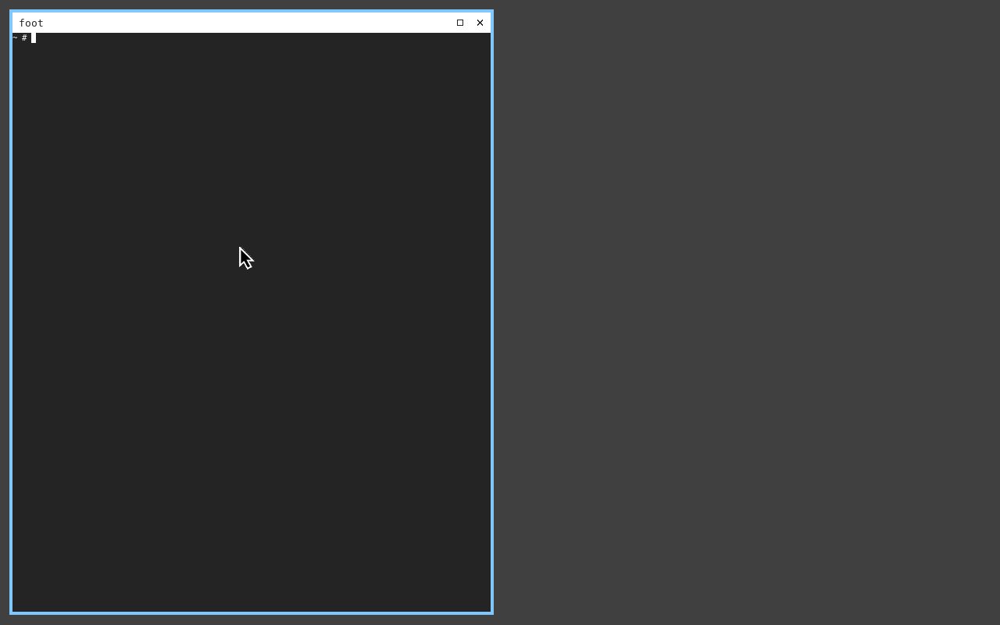

# RaviOS Milestone: Native Niri Desktop

**Milestone:** Native Niri Desktop Integration
**Release:** `milestone/native-niri-desktop`
**Release Type:** Pre-release
**Status:** Experimental Development Milestone
**Architecture:** x86_64
**Desktop Environment:** Niri / Wayland
**Primary Commit:** `63f502b`
**Date:** 2026-11-20

---

## 1. Overview

This milestone introduces a native Wayland desktop environment to RaviOS, built around the Niri scrollable-tiling Wayland compositor.

The objective was to extend RaviOS beyond its command-line-oriented environment and establish the foundation for a lightweight, native graphical desktop without relying on a conventional full desktop environment.

The implementation integrates Niri, Wayland infrastructure, desktop session management, terminal startup, localization, and supporting desktop components directly into the Buildroot-based operating system.

This milestone establishes the initial native desktop architecture and provides a foundation for future graphical applications and desktop functionality.

## 2. Key Features

### 2.1 Native Wayland Desktop

- Integrated the Niri Wayland compositor.
- Added the required desktop-related libraries and dependencies.
- Configured the operating system for native Wayland sessions.
- Added the required kernel configuration changes.

### 2.2 Desktop Session Management

- Introduced the `ravios-session` session launcher.
- Added an OpenRC service for automatic session startup.
- Implemented session initialization hooks.
- Integrated automatic Foot terminal startup.
- Established a dedicated session configuration structure.

### 2.3 Localization and Input

- Added system-wide locale configuration.
- Integrated locale initialization scripts.
- Configured the environment for multilingual input.
- Established the foundation for localized desktop applications.

### 2.4 Desktop Infrastructure

Added and integrated Buildroot packages for:

- Niri
- AppStream
- GNOME desktop-related dependencies
- ISO Codes
- libadwaita
- libdisplay-info
- libsass
- sassc
- XDG Desktop Portal
- XDG Desktop Portal GNOME

Some optional desktop components remain disabled or subject to dependency compatibility constraints.

## 3. Buildroot Integration

The native desktop implementation is integrated through the RaviOS Buildroot external tree.

Key integration areas include:

- External package definitions.
- Package configuration menus.
- Package dependency management.
- Package source hashes.
- Cross-compilation compatibility adjustments.
- Root filesystem overlays.
- Kernel configuration.
- Post-build configuration.

The implementation also extends the RaviOS build configuration to support the native graphical environment.

## 4. Session Architecture

The desktop session is organized around the following components:

| Component | Responsibility |
| --- | --- |
| `ravios-session` | Main session launcher |
| `S90ravios-session` | Automatic session startup |
| `10-foot.sh` | Foot terminal startup hook |
| `10-locale.sh` | Locale initialization |
| `/etc/environment` | System environment configuration |

Session configuration hooks are maintained under:

`/etc/ravios/session.d/`

This structure provides a modular foundation for future session services and desktop integrations.

## 5. Build and Image Generation

The milestone was built using the standard RaviOS build workflow through `build.ps1`.

Build configuration:

| Property | Value |
| --- | --- |
| Build System | Buildroot |
| Architecture | x86_64 |
| Target | VMware |
| Disk Image | 6 GB |
| Partitioning | UEFI |
| Filesystem | ext4 |
| Network | NAT / DHCP |

Generated artifacts:

- RAW disk image (`.img`)
- VMware virtual disk (`.vmdk`)
- VMware virtual machine configuration (`.vmx`)

The build process also generates the system inventory documentation.

## 6. Validation

The following validation steps were completed:

- Buildroot configuration successfully processed using `olddefconfig`.
- Full Buildroot build completed successfully.
- UEFI disk image generation completed successfully.
- RAW image verification completed successfully.
- VMware VMDK generation completed successfully.
- VMware VMX configuration generated successfully.
- System inventory regenerated successfully.
- Git staged changes passed `git diff --cached --check`.

Build inventory at the time of the final build:

| Metric | Result |
| --- | ---: |
| Installed Target Packages | 100 |
| BusyBox Applets | 263 |
| Standalone Executables | 257 |
| Non-BusyBox Symbolic Links | 36 |
| Active Kernel Options | 1333 |

## 7. First Successful Desktop Launch

The first successful launch of the native Niri desktop was verified in RaviOS running under VMware. The screenshot below records this initial graphical session, with the Foot terminal running inside the Niri Wayland environment.

*First successful native Niri desktop launch on RaviOS.*

## 8. Important Implementation Notes

- The desktop is based on Niri rather than a traditional GNOME or KDE desktop shell.
- Foot is used as the integrated terminal emulator.
- Session initialization is managed by RaviOS-specific scripts.
- XDG Desktop Portal infrastructure is included for desktop integration.
- GNOME Portal remains an optional component with dependency compatibility considerations.
- The AppStream cross-build patch prevents CLI metainfo generation from relying on unavailable target-side execution during cross-compilation.

## 9. Known Limitations and Future Work

This milestone establishes the initial native desktop foundation. It does not represent completion of all desktop functionality.

Potential future development areas include:

- Further graphical hardware compatibility testing.
- Additional desktop applications.
- Improved desktop settings and configuration tools.
- Screen capture and sharing integration.
- File chooser and desktop portal validation.
- Power management integration.
- Audio and multimedia desktop integration.
- Display configuration and multi-monitor support.
- Improved graphical login and session management.
- Broader VMware and VirtualBox compatibility testing.

Optional desktop components must be enabled only after their dependencies are compatible with the selected Buildroot package versions.

## 10. Git and Release Information

| Property | Value |
| --- | --- |
| Repository | `soroush-zendedel/RaviOS` |
| Branch | `develop/native-desktop-niri` |
| Commit | `63f502b` |
| Commit Message | `feat(desktop): add Niri Wayland desktop environment` |
| Release Tag | `milestone/native-niri-desktop` |
| Release Type | Pre-release |

GitHub Release:

<https://github.com/soroush-zendedel/RaviOS/releases/tag/milestone%2Fnative-niri-desktop>

## 11. Milestone Status

### Completed: Initial Native Niri Desktop Integration

The native Niri desktop integration has been successfully incorporated into the RaviOS source tree and built into a UEFI-compatible VMware image.

This milestone establishes the initial architecture for native graphical desktop support in RaviOS.

Further desktop functionality, compatibility improvements, and reliability testing will continue in subsequent development milestones.

---

**RaviOS Project**
Native Desktop Development
2026
